# 苏州大学实验室安全教育考试自动完成脚本

## 启动

直接右键启动 `元神启动.cmd`。 
脚本会检测浏览器**是否有安装油猴插件**，如果安装会如下显示：
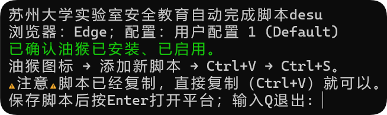

*如果没有，请按如下步骤安装油猴：*

## 安装油猴

以MicroSoft Edge浏览器为例，脚本应该会自动打开[安装油猴插件](https://microsoftedge.microsoft.com/addons/detail/%E7%AF%A1%E6%94%B9%E7%8C%B4/iikmkjmpaadaobahmlepeloendndfphd)的网址，点击最右边的「获取」：

安装成功后，网站应该会弹出提示**安装成功**的弹窗，就像这样：
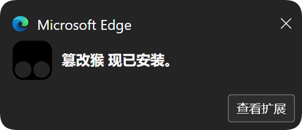

## 安装油猴脚本

以MicroSoft Edge浏览器为例，在浏览器右上角找到一个**像拼图碎片的图标**（它就是**插件管理控件**），点击它，然后点击「篡改猴」：
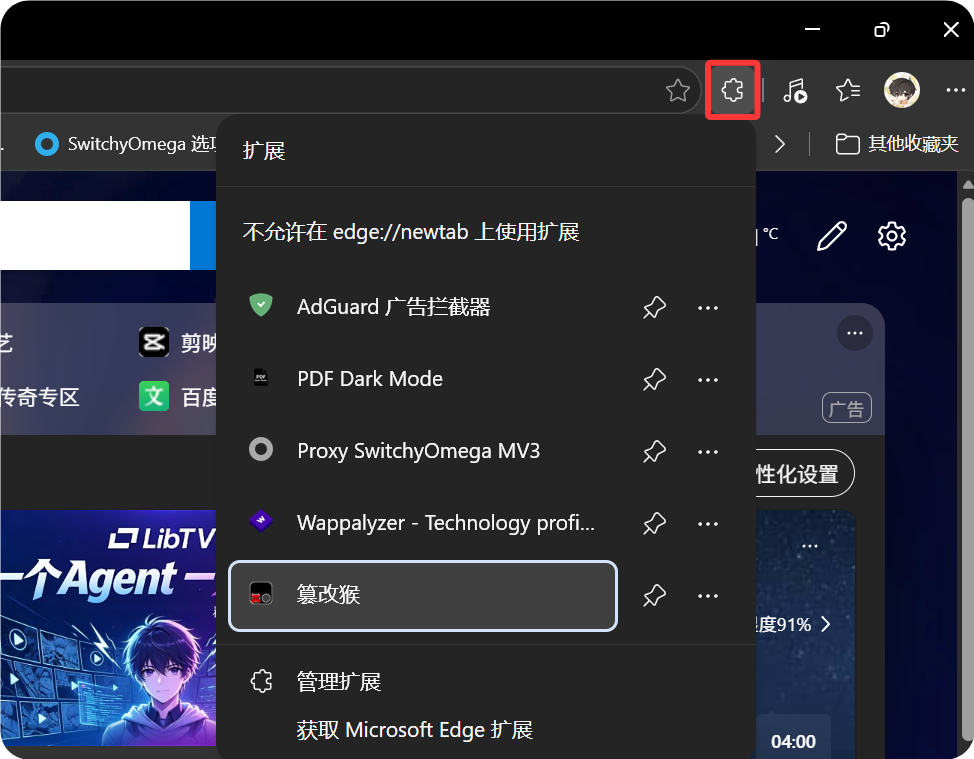

然后会进入以下界面，点击「添加新脚本」：
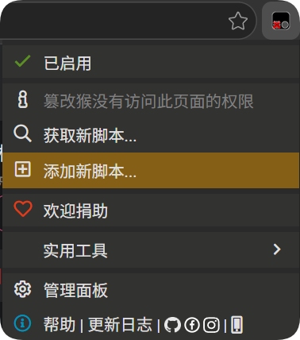

程序启动的时候，已经自动复制了一段油猴脚本。**直接 `Ctrl+A` 全选篡改猴里的示例脚本**：
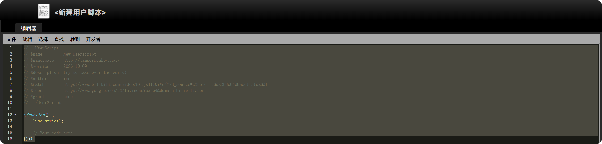

**`Ctrl+V` 复制**，由于油猴脚本比较大，可能需要等待几秒：
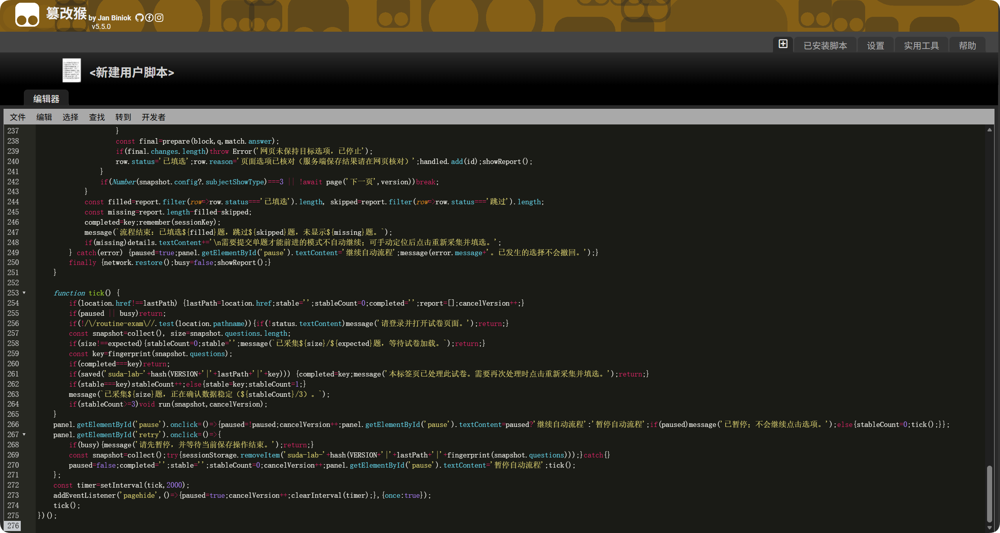

**`Ctrl+S` 保存**，这会自动保存并启用脚本，如下：
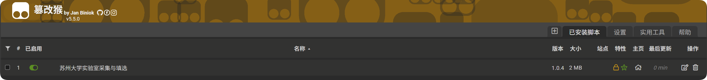

之后回到之前的 `元神启动.cmd` 中，**按 `Enter` 打开网址**：
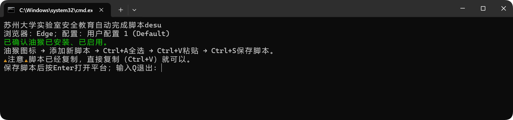

自行登录、签名，进入考试界面，发现右下角有个像下图中红框框起来的那个**神秘的窗口**，说明你♥成功了♥：

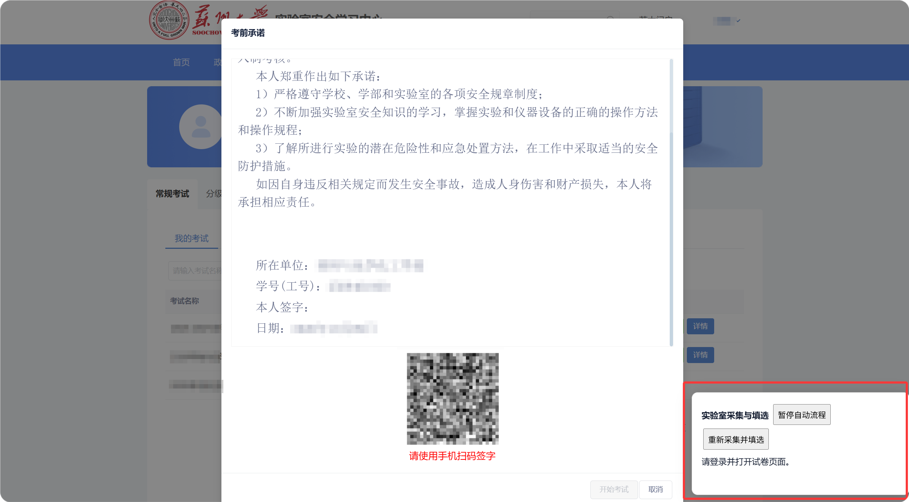

## 更快、更准、更强

进入答题界面后，便可看到右下角的那个神秘窗口开始工作起来了，只要静候一段时间就可以了：
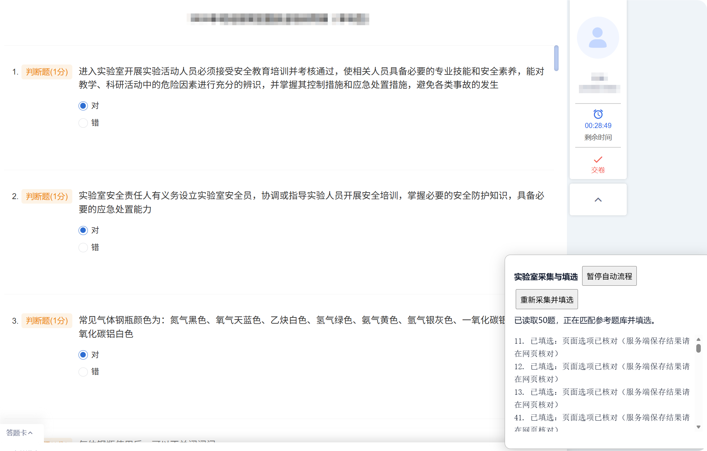
  

完成后，会像下图这样，提示完成了多少题，有多少题未在已有题库中找到 
（这真是没办法捏……题库是爬不到的捏，只能不断更新、壮大内置的题库qwq） 
未完成的题目（脚本跳过的题），就只能麻烦大家查一下AI啦。这种无法完成的题不会太多，一般是0~2题。
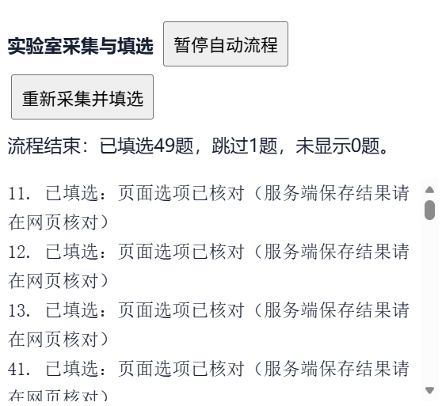

全部填选完成后，交卷！！满分！！！！！
